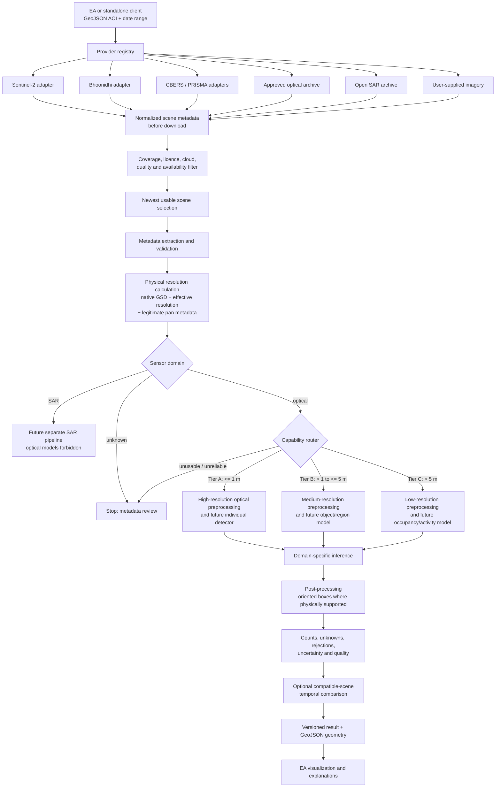

# Architecture

## Purpose and boundaries

`airfield-aircraft-vision` is a standalone service/library that searches imagery metadata, selects a usable scene, establishes its defensible physical resolution, and routes it only to validated analysis capabilities. It does not share models, datasets, package namespaces, or runtime state with `sentinel-ship-motion`. Epic Archer (EA) will integrate only through a versioned API contract.

VISION-0 implements contracts and routing, not provider access, downloads, training, or inference.

## Pipeline

## Components

### AOI input

The API accepts a GeoJSON Polygon or MultiPolygon in WGS84, plus an inclusive UTC date range and optional provider constraints. AOIs are validated for topology, area limits, antimeridian behavior, and provider coverage before search. The original AOI remains in result provenance.

### Provider abstraction and scene search

Each adapter implements the metadata-first `ImageryProvider` protocol in `providers/base.py`. Search returns normalized records without downloading pixels. Provider-specific identifiers and metadata remain available in a namespaced field, while core selection sees consistent sensor domain, footprint, acquisition time, GSD, bands, licence, preview, eligibility, authentication, archive/tasking mode, coverage cadence, and estimated size.

Adapters planned for Sentinel-2, Bhoonidhi, CBERS, PRISMA, ESA-approved sources, open SAR archives, and user-supplied imagery do not change core vision modules. Credentials remain adapter-owned and are never part of search requests or stored result contracts.

### Scene selection and quality filtering

Selection first rejects incompatible sensor domains, inadequate AOI coverage, prohibited licences, ineligible downloads, and scenes missing required trustworthy metadata. It then evaluates provider cloud metadata and, when previews are available, AOI-specific cloud, shadow, haze, snow, saturation, obstruction, georegistration, and usable-area indicators. Among usable scenes it normally favors the newest acquisition, but a slightly older usable scene may outrank a newer obscured scene. The rank explanation is retained.

Scene quality is not a cosmetic score. `unusable` stops routing; `poor` lowers the usable optical tier by one level (Tier C remains aggregate-only); `unknown` makes routing provisional pending assessment.

### Metadata extraction and GSD

The service preserves provider-stated pixel GSD, source band resolutions, projection/geotransform-derived pixel size, panchromatic GSD, pan-sharpened product spacing, and any documented effective spatial resolution. Inconsistencies are warnings or blockers. Effective spatial resolution may be poorer than pixel spacing because of the modulation transfer function, atmospheric effects, processing, motion, or resampling.

Routing uses the most conservative defensible physical value. For ordinary imagery this is no better than the worse of native GSD and known effective resolution. A pan-sharpened product is eligible for geometric routing only when the genuine source panchromatic GSD is known; the worse of panchromatic GSD, pan-product spacing, and known effective resolution governs. Upscaled and super-resolved pixel spacing is recorded but ignored for tier elevation.

### Capability selection and preprocessing

`capability.py` is the only implemented decision module. It returns a tier, allowed tasks, forbidden tasks, warnings, a reason, and governing resolution. The policy is detailed in `CAPABILITY_GATING.md`.

Preprocessing is model- and sensor-specific. It will handle radiometry, bands, tiling overlap, normalization, valid-data masks, geotransforms, and edge padding under a versioned preprocessing profile. Synthetic sensor degradation is a dataset process, not operational preprocessing, and must simulate blur, aggregation, resampling, haze, noise, contrast, compression, band response, shadows, and georegistration error rather than simple resize alone.

### Model routing and inference

There is no universal model. The planned routes are:

- Tier A high-resolution optical: individual oriented detection and broad morphology;
- Tier B medium-resolution optical: aircraft-like object/region and broad size outputs;
- Tier C low-resolution optical: occupancy, storage, activity, large-aircraft presence, and temporal change;
- SAR: separate future detector and validation program.

Model manifests must declare sensor domains, validated GSD interval, bands, preprocessing version, supported tasks/classes, calibration data, and evaluation version. A route is unavailable when no compatible validated model exists, even if nominal tier rules permit it.

### Post-processing, oriented boxes, and counting

Where individuals are resolved, post-processing preserves an oriented rectangle, confidence, full class distribution (including `unknown_aircraft`), approximate orientation/major axis, source resolution, sensor, timestamp, and uncertainty flags. Geospatial export transforms box corners through the scene geotransform into GeoJSON-compatible polygons; image-space boxes remain the numerical source of truth.

Counts explicitly reconcile:

`known classified + unknown = total accepted aircraft detections`

`total accepted + rejected = total candidates`

Rejected candidates are reported, not silently discarded. Tier B/C estimates may also carry a count range and method. Per-class counts are emitted only for classes permitted by the selected tier and validated model.

### Uncertainty

Uncertainty originates from scene quality, GSD/effective-resolution uncertainty, model confidence/calibration, class ambiguity, truncation/occlusion/shadow, geolocation, overlap merging, and temporal incompatibility. Warnings and unavailable-feature reasons are first-class output. `unknown_aircraft` remains a valid accepted result rather than being forced into a known class.

### Temporal comparison

Comparison requires compatible AOI coverage, georegistration, sensor domain, bands, physical resolution, season/illumination where relevant, and capability tier. It can report occupancy or activity change and count deltas only at the coarser mutually supported capability. A high-resolution scene never lends its class detail to an unresolved low-resolution scene.

### Eventual EA integration

EA sends AOI/search requests and renders normalized results. The service owns provider normalization, capability decisions, model routing, provenance, inference, and GeoJSON generation. EA owns user interaction and visualization. See `EA_INTEGRATION_CONTRACT.md`; no EA files are changed in VISION-0.

## Cross-cutting requirements

- UTC timestamps and explicit coordinate reference systems;
- immutable scene and model provenance;
- licence-aware data handling;
- coordinate-redacted public dataset exports where appropriate;
- structured warnings rather than guessed metadata;
- airfield-grouped evaluation and sensor/resolution-specific metrics;
- no claimed feature until both physical support and empirical validation exist.

