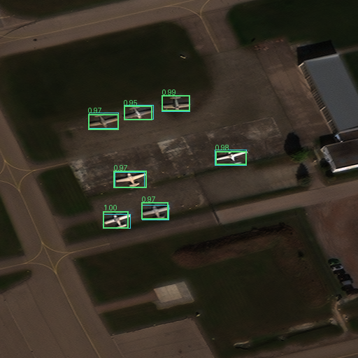
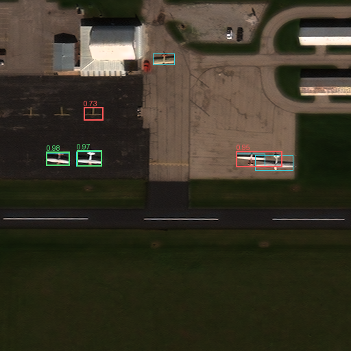
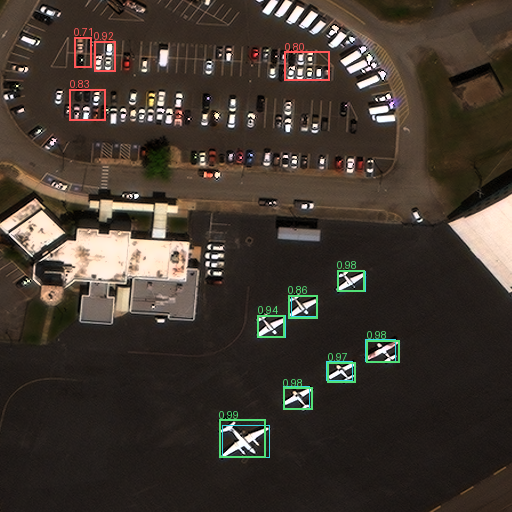
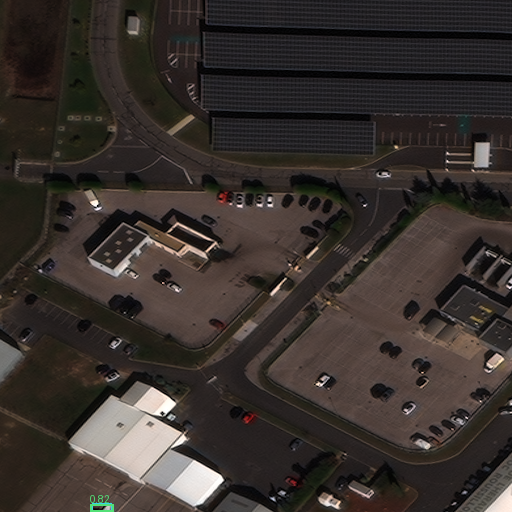

# AW-01D native-pixel examples

All examples are derived from cached frozen AW-01C predictions. Cyan boxes are source labels, green predictions match at IoU >= 0.5, red predictions are unmatched, gray indicates ignored regions. An unpaired cyan box is a miss. Images retain their native 512 x 512 pixel grid; display scaling does not add detail. Counts can coincide while localization is wrong.

## crowded-success

Source: 15_104005000DDC3800_tile_26.png; labelled 7, predicted 7.

## missed-aircraft

Source: 90_1040010003555D00_tile_25.png; labelled 5, predicted 4.

## false-positives

Source: 101_104001003BD74200_tile_160.png; labelled 7, predicted 11.

## partial-aircraft

Source: 10_10400100386D9000_tile_85.png; labelled 1, predicted 1.

See examples.json for checksums, acquisition precision, coordinates and matching evidence. These are selected successes/failures, not a random performance sample. RarePlanes derivatives retain CC BY-SA 4.0; see ../ATTRIBUTION.md.
