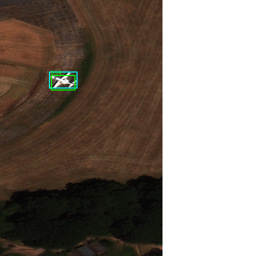
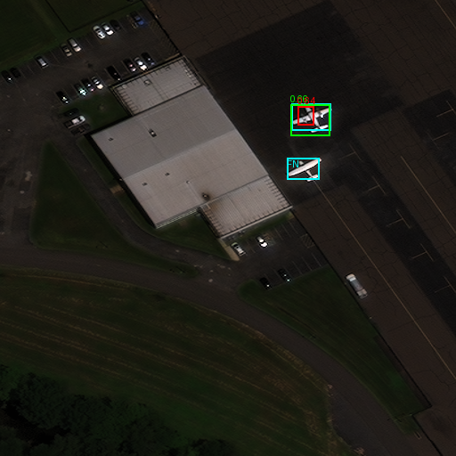
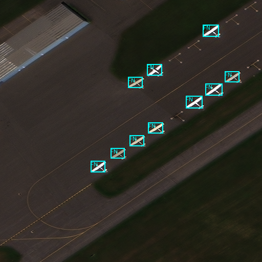

# AW-01 native-pixel examples

All are 512 x 512 overlays on downloaded RarePlanes PS-RGB tiles. No resize, sharpening or super-resolution.
Cyan = ground truth (FN marks misses); green = matched detection; red = unmatched detection.
Threshold 0.5; matching IoU 0.5. See [full measured results](../../AW01_VALIDATION.md).

## Matched validation detection

Tatenhill, location 36, catalog 104001003E76E200, tile 115.
One ground-truth aircraft, one matched detection; confidence about 0.64.

## Validation duplicate and missed aircraft

Manassas, location 45, catalog 104001000E6AB500, tile 46.
Two labelled aircraft; one matched detection, one unmatched partial duplicate and one false negative.
The equal predicted/labelled count does not imply correct detections.

## Independent test failure

Schenectady County, location 83, catalog 1040010032B86F00, tile 102.
Ten labelled aircraft, no accepted detections; all ten are false negatives.

## Attribution and derivative terms

RarePlanes Dataset, June 2020: J. Shermeyer, T. Hossler, A. Van Etten, D. Hogan, R. Lewis and D. Kim;
In-Q-Tel / CosmiQ Works and AI.Reverie.
[Dataset](https://www.iqt.org/library/the-rareplanes-dataset).
Images originate from RarePlanes real WorldView-3 imagery.

Changes: separate bounding-box/text overlays; original raster dimensions retained.
These image derivatives are distributed under [CC BY-SA 4.0](https://creativecommons.org/licenses/by-sa/4.0/);
retain attribution and indicate further changes. No endorsement or warranty.
See [supplied license](../../aw01/RAREPLANES_LICENSE.txt).
