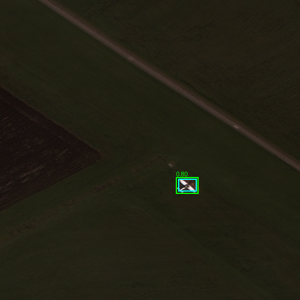
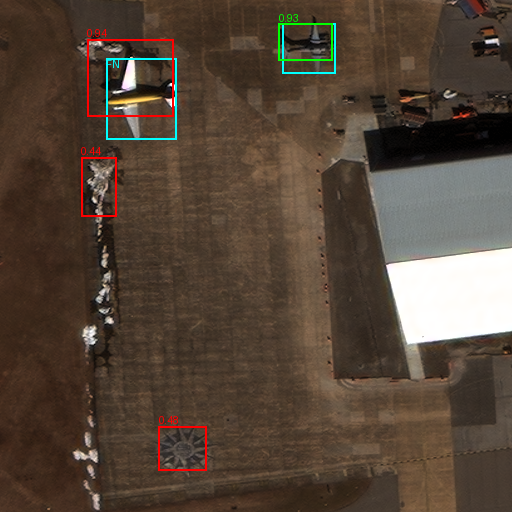
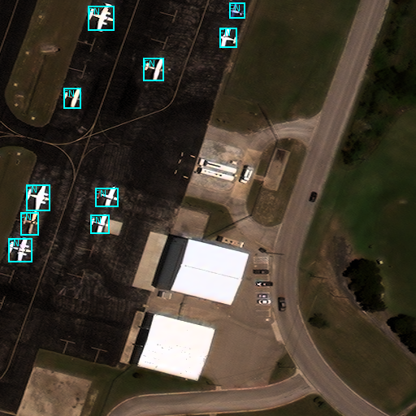
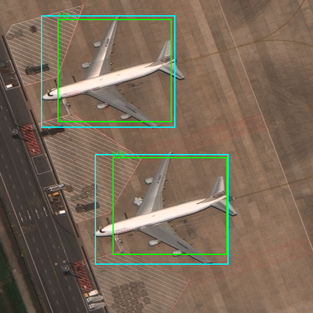

# AW-01B reviewed examples

Every image remains 512 x 512 at its delivered raster sampling. Cyan = ground truth/FN,
green = matched prediction, red = unmatched prediction. Confidence 0.4, IoU matching 0.5.
Scores are uncalibrated. See [full results](../../AW01B_VALIDATION.md).

## Fresh test: small-aircraft success

Flugplatz Antersberg, tile 41: one label, one matched detection, no FP/FN.

## Fresh test: localization and unmatched background patterns

Killeen, tile 147: two labels; one TP, three FP and one FN.
The upper-left high-score detection overlaps a true aircraft but fails IoU 0.5 because of its misplaced box.
Two additional unmatched candidates lie on snow/ground and cross-shaped scene patterns.
This is a supplied-label comparison, not proof that every unmatched pattern is a distinct false physical object.

## Fresh test: crowded-apron miss

Hagerstown, tile 64: ten labels, no accepted detections.

## Legacy regression: large-aircraft improvement

Shanghai Pudong, tile 957: two labels, two matched detections.
AW-01 at 0.5 accepted no detections on this same downloaded scene.
The scene/raster was not resized, sharpened or replaced.

## Attribution

RarePlanes Dataset, June 2020. J. Shermeyer, T. Hossler, A. Van Etten, D. Hogan, R. Lewis, D. Kim.
In-Q-Tel / CosmiQ Works and AI.Reverie.
[Dataset](https://www.iqt.org/library/the-rareplanes-dataset).
Changes: separate native-size label/detection overlays.
These derivatives retain [CC BY-SA 4.0](https://creativecommons.org/licenses/by-sa/4.0/).
No endorsement or warranty. See the [supplied license](../../aw01/RAREPLANES_LICENSE.txt).
