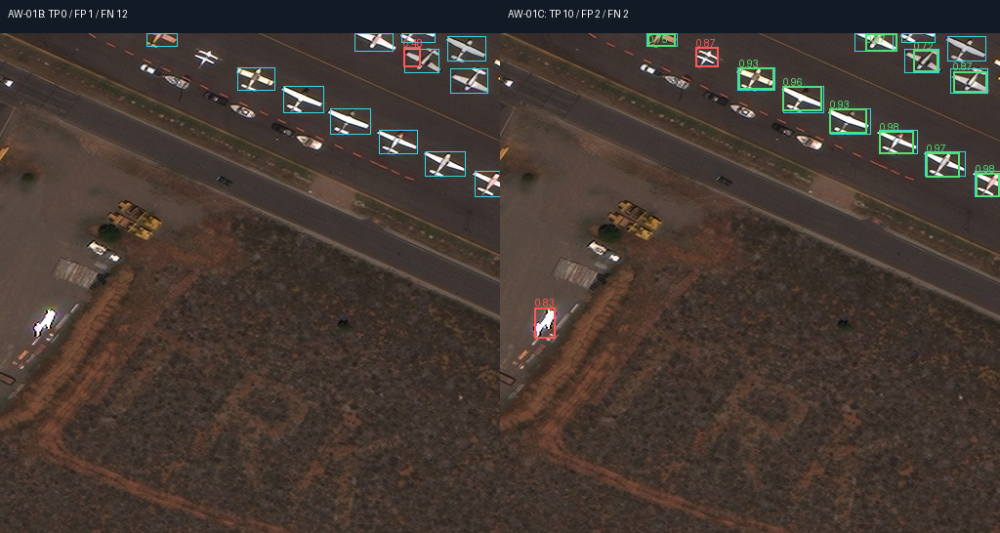
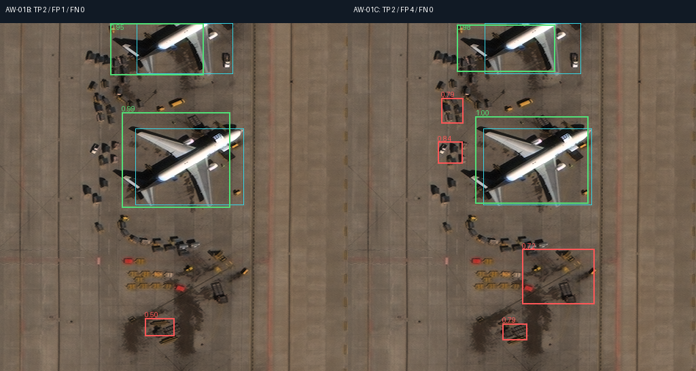
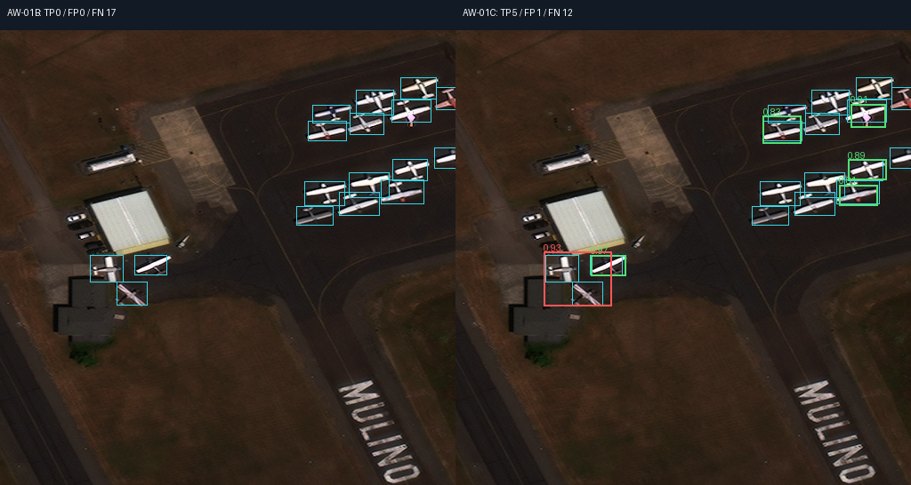

# AW-01C native detection comparisons

Left: preserved AW-01B threshold 0.4. Right: frozen AW-01C ResNet threshold 0.7. Both panels use the same original 512-pixel image and the exact predictions already scored in the independent evaluation. No new inference, resizing, sharpening or upscaling generates these examples.

Cyan: ground truth. Green: matched detection at IoU >=0.5. Red: unmatched prediction (which can include mislocalization). A cyan box without a green match is a missed label.

Examples are selected by outcomes to illustrate successes and failures; the full aggregate evaluation and first twelve lexical examples per model are recorded separately.

## success - 124_104001001F2A5700_tile_126.png

AW-01B TP/FP/FN: 0/1/12. AW-01C: 10/2/2.

## false-positives - 93_1040010048202D00_tile_1555.png

AW-01B TP/FP/FN: 2/1/0. AW-01C: 2/4/0.

## missed-aircraft - 119_104001003EA38900_tile_71.png

AW-01B TP/FP/FN: 0/0/17. AW-01C: 5/1/12.

## Attribution

RarePlanes Dataset, June 2020. J. Shermeyer, T. Hossler, A. Van Etten, D. Hogan, R. Lewis and D. Kim. In-Q-Tel / CosmiQ Works and AI.Reverie. [Dataset](https://www.iqt.org/library/the-rareplanes-dataset). [CC BY-SA 4.0](https://creativecommons.org/licenses/by-sa/4.0/). These derived detection overlays retain CC BY-SA 4.0. Original sources are unchanged. No endorsement or warranty. Exact source hashes and result records are in [index.json](index.json).
